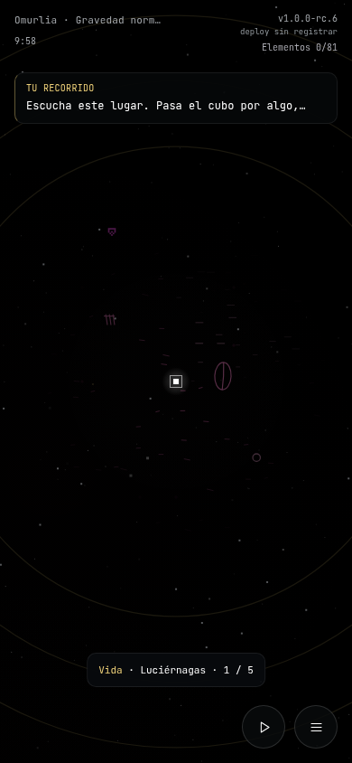
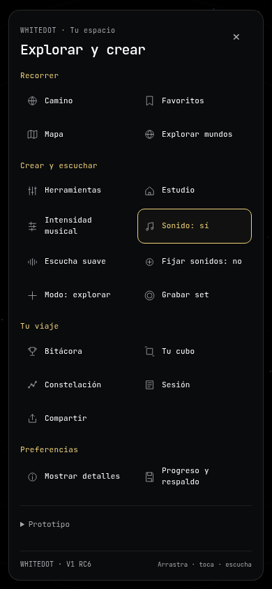
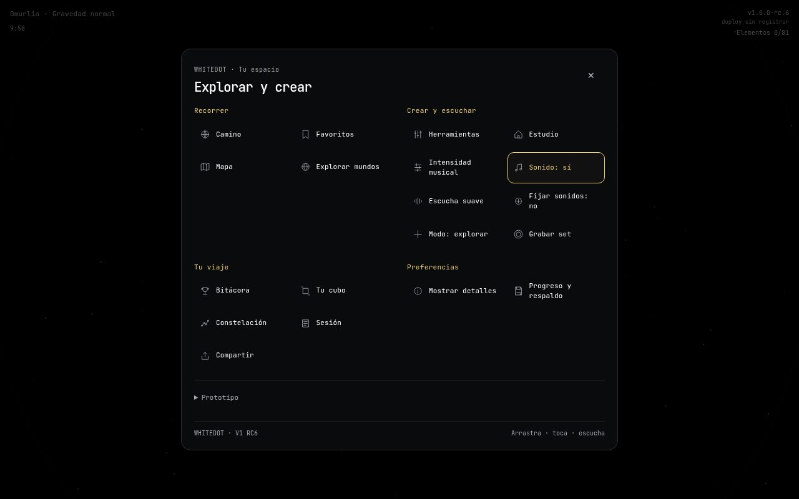
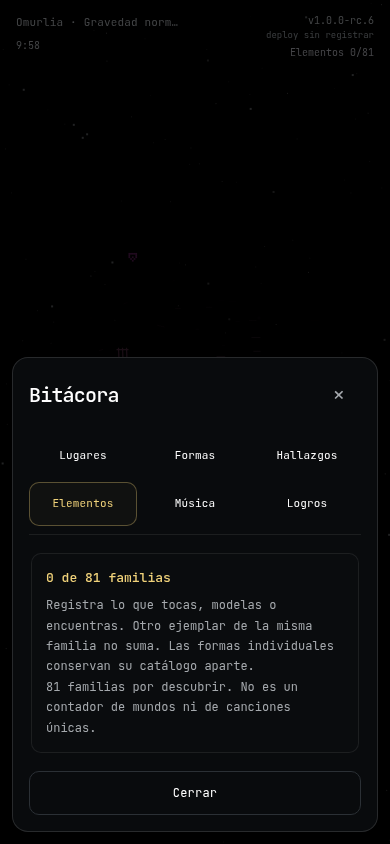
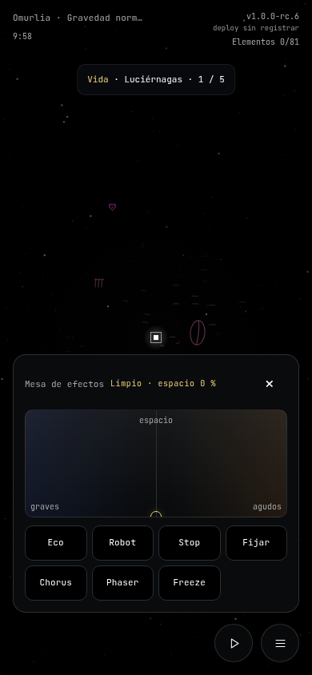

> Estado posterior: **1.1.0-alpha.10**, diez ramas del universo vivo. [Entrega y validación](ENTREGA_UNIVERSO_VIVO.md), [cobertura y pendientes](COBERTURA_150_UNIVERSO.md). El contenido que sigue conserva el contexto original de este documento; sus cifras/pendientes históricos no sustituyen el estado nuevo. Para continuar en Claude, leer primero [HANDOFF_CLAUDE.md](HANDOFF_CLAUDE.md).

# Interfaz integrada · V1 RC6

**1.0.0-rc.6 · polish/coherent-game-ui**, basada en **main `2a7dce0` (#84)**, que ya integra `feat/rare-discovery-cards` (`14e6862`) y todos sus padres. Una rama amplia con auditoría, diseño, navegación y correcciones; Jay crea PR y hace merge. Este bloque fue integrado y subido a main en `9b5fe00`, por autorización explícita posterior de Jay. No hay publicación nueva registrada. [Siguiente plan de 50 propuestas](UNIVERSO_50_IDEAS.md).

## Dirección y diagnóstico

El mundo ya tiene identidad: vacío negro, cubo blanco, pequeñas formas naturales y electrónicas, color localizado y música que responde. La interfaz acumulaba tratamientos distintos por entrega: cuadrículas de botones grandes, paneles cuadrados, textos diminutos y mayúsculas muy espaciadas. La solución es un lenguaje común de superficies oscuras, bordes finos, curvas discretas, tipografía monoespaciada legible y color para estados o descubrimientos.

El mundo conserva dos controles persistentes: paseo y menú. Las herramientas se piden; los detalles se activan. Un panel que el jugador abre deliberadamente puede ocupar más que un aviso: el límite de tamaño de los elementos del mundo no obliga a comprimir formularios hasta volverlos ilegibles. En pantallas cortas se desplaza el contenido dentro del panel, sin desplazar el juego; la cabecera y su cierre permanecen visibles. Los campos móviles usan 16 px para evitar el zoom automático por texto pequeño. Android puede redimensionar el contenido con el teclado; Safari y el teclado físico siguen dentro de la aceptación pendiente.

## Barrido del sistema

| Superficie | Problema observado | Mejora aplicada |
|---|---|---|
| Camino, Mundo y HUD | Tamaños y márgenes acumulados; versión muy pequeña | Márgenes seguros, texto con menos espaciado, reloj separado de versión/contador y estados coherentes |
| Menú | Todas las acciones tenían igual jerarquía en una pared de cuadrados | Cuatro grupos: Recorrer, Crear y escuchar, Tu viaje, Preferencias. Filas compactas con iconos de trazo fino; Prototipo separado |
| Instrumentos | El nombre sugería un catálogo aunque abría tres herramientas | Renombrado **Herramientas**, con acceso a Efectos, Eco y Estudio y etiquetas visibles al desplegarlas |
| Música | El panel de intensidad existía sin entrada visible | Nueva acción **Intensidad musical**. Se distingue de Sonido sí/no; abrirlo no cambia estilo ni género |
| Ayudas, cierre diario y linterna | Tablas/pasos cuadrados y tipografía distinta | Misma superficie, jerarquía y separadores finos. Se conservan las acciones de cada flujo |
| Bitácora, logros y elementos | Pestañas y tarjetas de estilos diferentes | Navegación segmentada, estados legibles y tarjetas con el mismo borde, radio, márgenes y tipografía |
| Hallazgos raros | Avisos podían consumir su tiempo ocultos tras herramientas | El reloj se pausa con efectos, espejos o un mensaje expandido. Libro/rareza siguen guardados; tarjetas comparten el lenguaje de la interfaz |
| Favoritos y coordenadas | Formularios/códigos sin lenguaje común | Campos legibles, botones táctiles, instrucciones y biblioteca en la misma superficie; WD1 sigue conservando identidad completa |
| Mapa y constelación | Canvas cuadrado podía desplazar todas las acciones | Vista contenida según altura disponible, marco discreto y métricas homogéneas |
| Tu cubo | Hoja especial distinta del resto | Cabecera, vista previa, colores y estados con el mismo diseño; color ganado y blanco disponible se preservan |
| Estudio | Bolsa y colores pequeños | Muestras desplazables horizontalmente, colores con zona táctil de 44 px y salida coherente |
| Efectos y espejos | Paneles cuadrados, cierre pequeño y foco perdido | Superficies comunes, controles de 44 px, cierre accesible; pad con flechas, Shift para paso mayor e Inicio para limpiar filtro/espacio |
| Eco y fijación | Funciones diferentes podían confundirse | Se mantienen separados Eco de dos compases, Grabar set y Fijar sonidos opcional; no se activa la fijación al abrir un menú |
| Escuchar | Mucha descripción en una superficie permanente | Panel contextual limitado a la altura; recorta fuentes para ajustarse y conserva acceso al detalle en Bitácora |
| Rutas y paseo | Avisos, destino y zona podían superponerse | Prioridad contextual: ruta frente a zona/frase, separación de avisos y controles táctiles consistentes |
| Grabar set y compartir | Botón rojo competía con la cabecera de versión | Control de grabación sobre el dock; rutas/avisos se separan. Exportación/descarga mantienen sus flujos y recursos |
| Voz y avisos | Mensaje desaparecía mientras se leía; control invisible aún tabbable | Leer un mensaje lo mantiene abierto. Escape contrae. Al desaparecer deja de recibir Tab y devuelve foco; anuncio completo separado del efecto de escritura |
| Progreso, respaldo y actualización PWA | Controles de mantenimiento mezclados con exploración | Grupo Preferencias; hojas y formularios comunes. Recuperación, exportación, importación y espera de actualización siguen disponibles |
| Semillas, atlas y laboratorio | Estilos y controles del prototipo diferentes | Misma superficie, contraste, botones y estados; desplazamiento interno en móvil y horizontal |
| Teclado y lectores de pantalla | Foco podía salir por un details cerrado; Escape de otro módulo robaba foco | Summary participa en el recorrido y sus controles cerrados no. Fondo inerte durante modal; solo cambios reales de apertura/cierre restauran foco |
| Zoom y movimiento reducido | Viewport prohibía ampliar texto | Se elimina el bloqueo explícito de zoom. Se conserva el gesto del juego y se respetan preferencias de movimiento reducido |

## Reglas para siguientes incorporaciones

- `styles/game.css` conserva la base y los estados del juego; **`styles/interface.css` es la capa común de diseño** y se carga después. Añadir allí los tratamientos compartidos, sin inventar una estética por módulo.
- Usar negro y superficies próximas al negro; blancos/grises para lectura, dorado para selección y las tintas propias de cada hallazgo. No añadir sonido de confirmación al menú.
- Botones de al menos 44 px; controles persistentes pocos, contenido secundario en hojas. No convertir el mundo en un teclado de botones.
- Encabezado y cierre de hoja reutilizan la acción real de cada módulo. Tab permanece en el diálogo; al cerrarlo vuelve al control visible o al mundo. No tocar la semilla para arreglar un problema de interfaz.
- Las coordenadas, generadores, guardados, catálogo de 11 biomas/33 hábitats/52 géneros, 81 familias y 18 tipos de tarjeta conservan su significado. Esta entrega no aumenta el número de mundos ni añade instrumentos.

## Capturas reales

Capturadas en Chromium desde la aplicación, sin dibujos simulados. Semilla `bosque-01`, Vasto, generador 2. La fecha de deploy desconocida se muestra como desconocida.

## Validación y aceptación restante

**59 suites de lógica, 45/45 recorridos de navegador y offline aprobados. Integridad: 105 módulos, 242 IDs, 245 imports, 117 assets; cero errores y avisos.** La evidencia final queda en [registro RC6](../../scripts/interface-validation.json) y [auditoría de integridad](../../scripts/interface-integrity-validation.json). Los ensayos nuevos recorren ocho hojas reales en 320×568, 360×640, 390×844, 844×390 y 1280×800: límites de pantalla, desplazamiento interno, botones de 44 px, foco, acceso a intensidad y pad por teclado. Se verifica además la pausa de tarjetas detrás de herramientas y la lectura/expiración de mensajes. La suite general cubre Camino, Mundo, Estudio, audio, criaturas, registro, guardado, grabación y PWA/offline.

No hay cambios de DSP, secuenciador, géneros o generación. Las 225 mezclas de RC4 siguen siendo evidencia previa; no son un ensayo de audio nuevo de RC6. Ajustar un efecto o la intensidad cambia deliberadamente la música existente; navegar no añade notas, pulsos ni jingles.

| Pendiente | Plan concreto |
|---|---|
| iPhone/Android físicos | Probar arrastre, teclado virtual, campos, safe areas, grabar/descargar, PWA instalada y una sesión larga en ambas orientaciones |
| Descubrimiento por primera vez | Sesión de alguien nuevo; comprobar si distingue tocar, escuchar, fijar, Eco y Grabar set; ajustar ayudas según esa observación |
| Accesibilidad del mundo Canvas | Navegación/diálogos sí tienen teclado y anuncios; explorar el universo solo con lector de pantalla exige una representación adicional en V2 |
| Zoom y texto ampliado en móviles | El viewport permite zoom; el Canvas mantiene touch-action de juego. Validar ampliación asistiva/texto grande en Safari y Android reales |
| Pantalla corta con contenido largo | El panel se desplaza y todos los controles siguen accesibles. Validar comodidad al introducir texto con teclado virtual físico |
| Revisión remota/publicación | Jay crea PR de esta rama hacia main y revisa CI. Después elegir host HTTPS, respaldar partida y registrar la hora real en el artefacto; no inventar deploy |

Esta es una mejora integrada de la candidata V1, no una garantía de aceptación artística o de todos los dispositivos. El siguiente paso es probarla jugando y resolver hallazgos de esa prueba antes de publicar.
